# 🎫 TickTrack - Support Ticket Management System

TickTrack adalah aplikasi manajemen tiket bantuan teknis (*helpdesk / support ticketing system*) berbasis web full-stack. Dibangun dengan memisahkan arsitektur backend (**Laravel 12 RESTful API**) dan frontend (**Vue 3 Single Page Application**), TickTrack dirancang untuk mempermudah pelaporan kendala, pelacakan status penanganan, komunikasi antara tim support dan pengguna, serta analisis performa layanan secara real-time.

---

## 📑 Daftar Isi

- [Fitur Utama](#-fitur-utama)
- [Teknologi yang Digunakan](#-teknologi-yang-digunakan)
- [Arsitektur Sistem](#-arsitektur-sistem)
- [Struktur Direktori](#-struktur-direktori)
- [Spesifikasi Database & Model](#-spesifikasi-database--model)
- [Panduan Instalasi & Menjalankan Aplikasi](#-panduan-instalasi--menjalankan-aplikasi)
  - [Prasyarat Sistem](#prasyarat-sistem)
  - [1. Konfigurasi Backend (Laravel API)](#1-konfigurasi-backend-laravel-api)
  - [2. Konfigurasi Frontend (Vue 3)](#2-konfigurasi-frontend-vue-3)
- [Kredensial Default](#-kredensial-default)
- [Dokumentasi REST API](#-dokumentasi-rest-api)
- [Hak Akses & Alur Kerja](#-hak-akses--alur-kerja)

---

## ✨ Fitur Utama

### 👤 Role Pengguna (User / Klien)
- **Autentikasi Akun**: Registrasi mandiri dan login menggunakan token aman (Laravel Sanctum).
- **Pembuatan Tiket Bantuan**: Form tiket baru dengan penetapan prioritas (*Low*, *Medium*, *High*) dan generate kode unik otomatis (`TIC-xxxxx`).
- **Dashboard Personal**: Pemantauan status tiket milik pengguna secara real-time.
- **Diskusi & Thread Percakapan**: Melampirkan balasan pesan pada tiket untuk memperjelas kendala ke tim support.

### 🛠️ Role Administrator (Support Team)
- **Dashboard Statistik & Analitik**:
  - Total tiket yang dibuat pada bulan berjalan.
  - Jumlah tiket aktif (*Open* & *On Progress*).
  - Jumlah tiket terselesaikan (*Resolved*).
  - Rata-rata waktu penyelesaian kendala (*Average Resolution Time* dalam satuan jam).
  - Grafik distribusi status tiket menggunakan visualisasi **Chart.js**.
- **Manajemen & Filter Tiket**:
  - Pencarian tiket secara dinamis berdasarkan kode tiket atau judul.
  - Filter tiket berdasarkan status (`open`, `onprogress`, `resolved`, `rejected`).
  - Filter tiket berdasarkan tingkat prioritas (`low`, `medium`, `high`).
- **Penyelesaian Kendala (Resolusi)**:
  - Membalas tiket dari pengguna.
  - Memperbarui status pengerjaan tiket.
  - Otomatis mencatat waktu selesai (`completed_at`) saat status diubah menjadi *Resolved*.

---

## 🚀 Teknologi yang Digunakan

### Backend (`api-tick-track/`)
| Komponen | Deskripsi |
|---|---|
| **Framework** | [Laravel 12](https://laravel.com/) (PHP ^8.2) |
| **Authentication** | [Laravel Sanctum](https://laravel.com/docs/sanctum) (API Token / Bearer) |
| **Database** | MySQL / MariaDB (Mendukung PostgreSQL / SQLite) |
| **Testing** | [Pest PHP](https://pestphp.com/) |

### Frontend (`fe-ticktrack/`)
| Komponen | Deskripsi |
|---|---|
| **Framework** | [Vue 3](https://vuejs.org/) (Composition API & `<script setup>`) |
| **Build Tool** | [Vite 6](https://vitejs.dev/) |
| **State Management** | [Pinia 3](https://pinia.vuejs.org/) |
| **Routing** | [Vue Router 4](https://router.vuejs.org/) (Navigation Guards terintegrasi) |
| **HTTP Client** | [Axios](https://axios-http.com/) (dengan Interceptors untuk Authorization Token) |
| **Visualisasi & Ikon** | [Chart.js 4](https://www.chartjs.org/) & [Feather Icons](https://feathericons.com/) |
| **Date Utility** | [Luxon](https://moment.github.io/luxon/) |

---

## 🏛️ Arsitektur Sistem

```mermaid
flowchart LR
    subgraph Frontend["Frontend (fe-ticktrack) - Vue 3 / Vite"]
        UI["Antarmuka Pengguna & Admin"]
        Router["Vue Router (Route Guards)"]
        Pinia["Pinia Store (Auth & Tickets)"]
        Axios["Axios Interceptor (Bearer Token)"]

        UI --> Router
        Router --> Pinia
        Pinia --> Axios
    end

    subgraph Backend["Backend (api-tick-track) - Laravel 12 API"]
        Sanctum["Laravel Sanctum (Auth Middleware)"]
        Controllers["Controllers (Auth, Ticket, Dashboard)"]
        Eloquent["Eloquent Models & Migrations"]
        DB[(MySQL Database)]

        Sanctum --> Controllers
        Controllers --> Eloquent
        Eloquent --> DB
    end

    Axios -- "HTTP / REST API (JSON)" --> Sanctum
```



---

## 📁 Struktur Direktori

```text
TickTrack/
├── api-tick-track/                 # Backend RESTful API (Laravel 12)
│   ├── app/
│   │   ├── Http/
│   │   │   ├── Controllers/        # AuthController, TicketController, DashboardController
│   │   │   ├── Requests/           # Form Requests (Validation)
│   │   │   └── Resources/          # API Resource Transformers (JSON Formatting)
│   │   └── Models/                 # User, Ticket, TicketReply
│   ├── database/
│   │   ├── migrations/             # Migrasi tabel users, tickets, ticket_replies, dll.
│   │   └── seeders/                # DatabaseSeeder (Default Admin)
│   ├── routes/
│   │   └── api.php                 # Definisi rute REST API
│   └── composer.json
│
├── fe-ticktrack/                   # Frontend SPA (Vue 3 + Vite)
│   ├── src/
│   │   ├── components/             # Reusable UI components
│   │   ├── layouts/                # Admin.vue, App.vue (User), Auth.vue
│   │   ├── plugins/
│   │   │   └── axios.js            # Inisialisasi Axios baseURL & interceptor token
│   │   ├── router/
│   │   │   └── index.js            # Rute navigasi & middleware auth guard
│   │   ├── stores/                 # Pinia stores (auth.js, ticket.js, dashboard.js)
│   │   ├── views/
│   │   │   ├── admin/              # Halaman Dashboard & Kelola Tiket Admin
│   │   │   ├── app/                # Halaman Dashboard & Buat Tiket User
│   │   │   └── auth/               # Login & Register
│   │   ├── App.vue
│   │   └── main.js
│   ├── package.json
│   └── vite.config.js
│
└── README.md                       # Dokumentasi utama proyek
```

---

## 🗄️ Spesifikasi Database & Model

### 1. Tabel `users`
- `id` (Primary Key)
- `name` (string)
- `email` (string, unique)
- `password` (hashed)
- `role` (enum: `user`, `admin`, default: `user`)
- `timestamps`

### 2. Tabel `tickets`
- `id` (Primary Key)
- `user_id` (Foreign Key ke `users.id`)
- `code` (string, unique, format: `TIC-XXXXX`)
- `title` (string)
- `description` (longText)
- `status` (enum: `open`, `onprogress`, `resolved`, `rejected`, default: `open`)
- `priority` (enum: `low`, `medium`, `high`)
- `completed_at` (timestamp, nullable - terisi saat status diset ke `resolved`)
- `timestamps` & `softDeletes`

### 3. Tabel `ticket_replies`
- `id` (Primary Key)
- `ticket_id` (Foreign Key ke `tickets.id`)
- `user_id` (Foreign Key ke `users.id`)
- `content` (text)
- `timestamps`

---

## 🛠️ Panduan Instalasi & Menjalankan Aplikasi

### Prasyarat Sistem
Pastikan perangkat Anda telah terpasang:
- **PHP** versi >= 8.2
- **Composer** versi >= 2.x
- **Node.js** versi >= 18.x atau **Bun**
- **MySQL / MariaDB** (dapat menggunakan Laragon, XAMPP, atau Docker)

---

### 1. Konfigurasi Backend (Laravel API)

1. Buka terminal dan masuk ke folder `api-tick-track`:
   ```bash
   cd api-tick-track
   ```

2. Pasang dependensi PHP:
   ```bash
   composer install
   ```

3. Salin berkas lingkungan (`.env`):
   ```bash
   cp .env.example .env
   ```

4. Buat database baru di MySQL dengan nama `api_tick_track` (atau sesuaikan dengan konfigurasi Anda).

5. Sesuaikan konfigurasi koneksi database di berkas `.env`:
   ```env
   DB_CONNECTION=mysql
   DB_HOST=127.0.0.1
   DB_PORT=3306
   DB_DATABASE=api_tick_track
   DB_USERNAME=root
   DB_PASSWORD=
   ```

6. Generate App Key Laravel:
   ```bash
   php artisan key:generate
   ```

7. Jalankan migrasi dan seeding data default:
   ```bash
   php artisan migrate --seed
   ```

8. Jalankan server lokal Laravel:
   ```bash
   php artisan serve
   ```
   *Backend API akan berjalan pada `http://127.0.0.1:8000`*.

---

### 2. Konfigurasi Frontend (Vue 3)

1. Buka terminal baru dan masuk ke folder `fe-ticktrack`:
   ```bash
   cd fe-ticktrack
   ```

2. Pasang dependensi JavaScript:
   ```bash
   npm install
   # atau jika menggunakan bun:
   # bun install
   ```

3. *(Opsional)* Periksa konfigurasi endpoint API pada [fe-ticktrack/src/plugins/axios.js](fe-ticktrack/src/plugins/axios.js):
   ```javascript
   axios.defaults.baseURL = 'http://localhost:8000/api'
   ```

4. Jalankan server pengembang Vite:
   ```bash
   npm run dev
   # atau jika menggunakan bun:
   # bun run dev
   ```

5. Buka browser Anda dan akses tautan lokal yang ditampilkan di terminal (umumnya `http://localhost:5173`).

---

## 🔑 Kredensial Default

Setelah menjalankan `php artisan migrate --seed`, Anda dapat langsung menggunakan akun bawaan untuk login sebagai Administrator:

| Parameter | Akun Admin |
|---|---|
| **Email** | `admin@ticktrack.com` |
| **Password** | `password` |
| **Role** | `admin` (Diarahkan ke `/admin/dashboard`) |

> 💡 **Akun User**: Anda dapat mendaftar akun baru melalui tombol **Register** pada halaman login (`/auth/register`). Akun yang didaftarkan mandiri otomatis memiliki role `user`.

---

## 📡 Dokumentasi REST API

Base URL: `http://localhost:8000/api`

### 1. Autentikasi

| Method | Endpoint | Auth | Deskripsi |
|---|---|:---:|---|
| `POST` | `/register` | Public | Mendaftarkan akun user baru (`name`, `email`, `password`) |
| `POST` | `/login` | Public | Login akun & mendapatkan Bearer Token (`email`, `password`) |
| `GET` | `/me` | Sanctum | Mendapatkan profil akun yang sedang login saat ini |
| `POST` | `/logout` | Sanctum | Menghapus token autentikasi sesi saat ini |

### 2. Dashboard

| Method | Endpoint | Auth | Role | Deskripsi |
|---|---|:---:|:---:|---|
| `GET` | `/dashboard/statistics` | Sanctum | Admin | Mengambil metrik total tiket, tiket aktif, terselesaikan, rata-rata waktu selesai, dan sebaran status |

### 3. Tiket (*Tickets*)

| Method | Endpoint | Auth | Deskripsi |
|---|---|:---:|---|
| `GET` | `/ticket` | Sanctum | Mengambil daftar tiket (User hanya melihat tiket miliknya; Admin melihat seluruh tiket dengan parameter filter `search`, `status`, `priority`) |
| `POST` | `/ticket` | Sanctum | Membuat tiket baru (`title`, `description`, `priority`) |
| `GET` | `/ticket/{code}` | Sanctum | Mengambil detail tiket beserta riwayat tanggapan (*replies*) berdasarkan kode tiket |
| `POST` | `/ticket-reply/{code}` | Sanctum | Mengirimkan balasan pada tiket. Admin dapat menyertakan field `status` untuk memperbarui status pengerjaan tiket |

---

## 🚦 Hak Akses & Alur Kerja

```
[ Pengguna / User ]
    └── Buat Tiket (Status: Open)
          └── Diskusi & Menunggu Tanggapan
                └── Tiket Selesai (Status: Resolved)

[ Admin / Support ]
    └── Pantau Dashboard Statistik
          └── Lihat Daftar Tiket Masuk & Filter Masalah
                └── Tindak Lanjut Tiket (Status: On Progress)
                      └── Berikan Solusi & Tutup Tiket (Status: Resolved / Rejected)
```

1. **User** membuat laporan tiket dengan memilih prioritas kendala.
2. Tiket masuk ke sistem dengan status awal **`open`**.
3. **Admin** menerima tiket melalui halaman *Ticket List*, lalu mengubah status menjadi **`onprogress`** saat proses investigasi atau perbaikan.
4. User dan Admin dapat saling berkirim pesan melalui antarmuka balasan (*reply thread*).
5. Setelah solusi diberikan, Admin mengubah status tiket menjadi **`resolved`**, yang secara otomatis mencatat waktu penyelesaian (`completed_at`) untuk kalkulasi performa (*Average Resolution Time*) pada dashboard.
